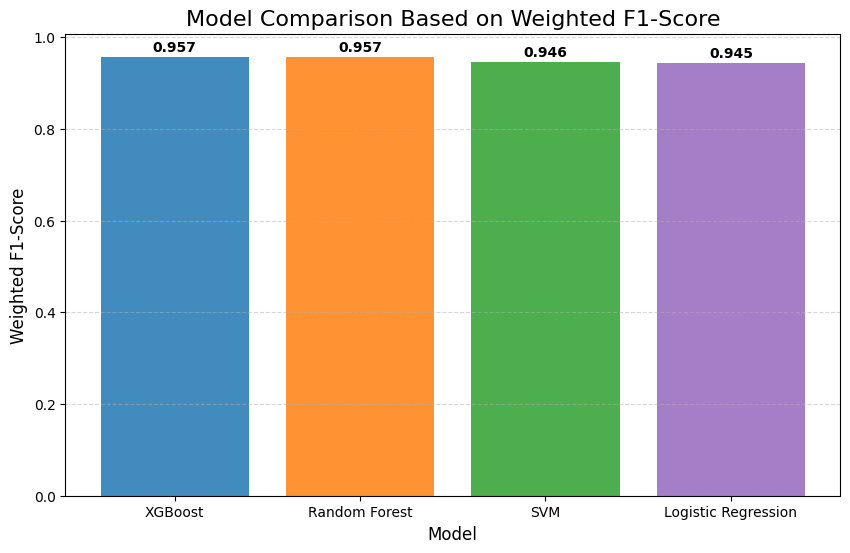
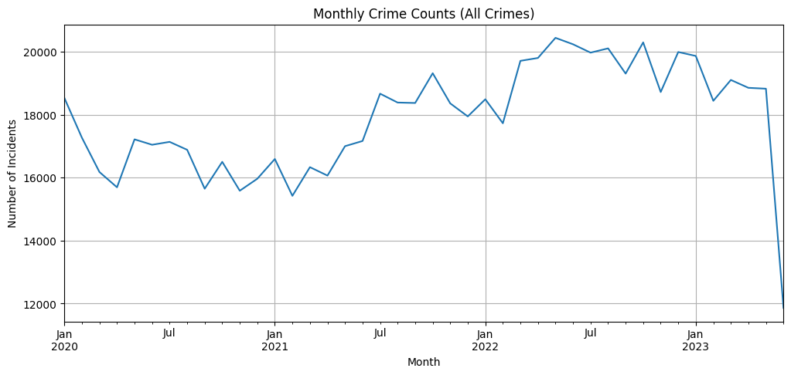

# COVID-19 Lockdowns and Urban Crime in Los Angeles

**Danish Ahsan Khan | MSc Data Analytics, Dublin Business School**

A Python analysis of recorded crime patterns in Los Angeles, combining temporal
exploration with machine learning classification of violent and non-violent
incidents. The study window is **1 January 2020 to 19 June 2023**.

[View the completed notebook](notebooks/crime_analysis.ipynb) · [Open in Google Colab](https://colab.research.google.com/github/danishkhan1938/la-crime-lockdown-analysis/blob/main/notebooks/crime_analysis.ipynb) · [Methods and review notes](docs/REVIEW_NOTES.md)

**Run status:** original dissertation workflow rerun on 13 November 2026, with
saved figures and results. The validation limitations documented below apply.
These rerun results should be distinguished from figures in the written report.

## Research questions

- How do recorded incident counts and common offence categories vary across the study's defined pandemic phases?
- How accurately do Logistic Regression, Random Forest, SVM and XGBoost classify recorded incidents as violent or non-violent using the selected incident attributes?

## Data and experiment sizes

| Stage | Records |
|---|---:|
| Supplied raw CSV | 910,707 |
| Study period after filtering | 750,936 |
| Training partition before sampling | 525,655 |
| Training sample used for modelling | **10,000** |
| Training sample after SMOTE | 14,376 |
| Separate, unresampled test set | **225,281** |

The models use **12 predictors** and a stratified 70/30 train/test split with
`random_state=42`. Five-fold grid search tunes weighted F1. The original method
fits preprocessing and SMOTE before cross-validation; this can bias CV scores.
Ordinary SMOTE on ordinal category codes is another limitation. See the
[review notes](docs/REVIEW_NOTES.md) before interpreting the results.

## Test results from the completed rerun

| Model | Accuracy | Weighted F1 |
|---|---:|---:|
| XGBoost | 95.69% | 0.957480 |
| Random Forest | 95.63% | 0.956839 |
| SVM | 94.62% | 0.946133 |
| Logistic Regression | 94.47% | 0.944520 |

The table matches the saved notebook outputs. XGBoost has the highest observed
test scores in this run, with Random Forest close behind. No significance test
establishes a reliable difference between them.



The notebook includes all four confusion matrices. Exact counts, test metrics,
selected hyperparameters and original CV scores are in
[`results/model_details.json`](results/model_details.json).

## Temporal exploration



**June 2023 contains only 1–19 June.** The final point covers an incomplete
month and should not be interpreted as a sudden full-month reduction.

The study phases have different lengths. Daily averages provide a duration-adjusted
description of recorded counts; they are not population-adjusted crime rates.

| Project phase | Dates | Incidents | Calendar days | Incidents per day |
|---|---|---:|---:|---:|
| Pre-Lockdown | 2020-01-01 to 2020-03-18 | 45,859 | 78 | 587.94 |
| Lockdown | 2020-03-19 to 2021-01-31 | 170,348 | 319 | 534.01 |
| Post-Lockdown | 2021-02-01 to 2023-06-19 | 534,729 | 869 | 615.34 |

These are descriptive associations. The analysis does not isolate lockdowns
from seasonality, reporting changes or other causes.

## Files

| Path | Contents |
|---|---|
| `notebooks/crime_analysis.ipynb` | Completed notebook with code, charts and model outputs |
| `figures/` | Ten charts extracted from this notebook |
| `results/saved_run_metrics.csv` | Current test accuracy and weighted F1 |
| `results/model_details.json` | Confusion matrices, detailed metrics, best parameters and CV caveats |
| `results/phase_summary.csv` | Phase counts, durations and daily averages |
| `results/run_summary.json` | Dataset and notebook hashes, sample sizes and provenance |
| `data/README.md` | Source and dataset setup |
| `docs/REVIEW_NOTES.md` | Method limitations and report reconciliation |
| `docs/UPLOAD_GUIDE.md` | Steps to update the existing GitHub repository |
| `requirements.txt` | Dependencies imported by the original workflow |

## Run the notebook

**Google Colab:** open the link above, save a copy, and upload
`Crime_Data_from_2020_to_Present.csv` through the Files panel. Run the cells from
top to bottom. The data-loading cell accepts the normal Colab `/content/` location.

**Local Jupyter:** place the same CSV in `data/`, create a Python environment,
install the dependencies, and open the notebook:

```bash
python -m pip install -r requirements.txt
jupyter lab
```

The exact original package versions were not recorded. The requirements file
lists dependencies, not a tested environment lockfile. Full model grid searches
and SVM prediction on the large test set can take time.

## Interpretation and reuse

- The target follows a project-specific list of offence descriptions. Recorded weapon and other incident attributes make this retrospective classification, not validated future-crime forecasting.
- Raw phase totals cover unequal durations. Use the daily averages above for descriptive comparison.
- The original age-zero handling, resampling and validation design require review before stronger research claims.
- Dataset provider terms govern data reuse. The CSV is not included in this repository. No open-source licence has been selected for the author's code.

The report and presentation are not included in this code package. Reconcile
their figures with the rerun before adding public copies.
